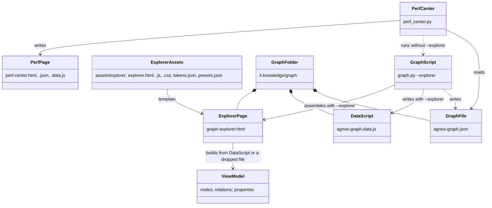
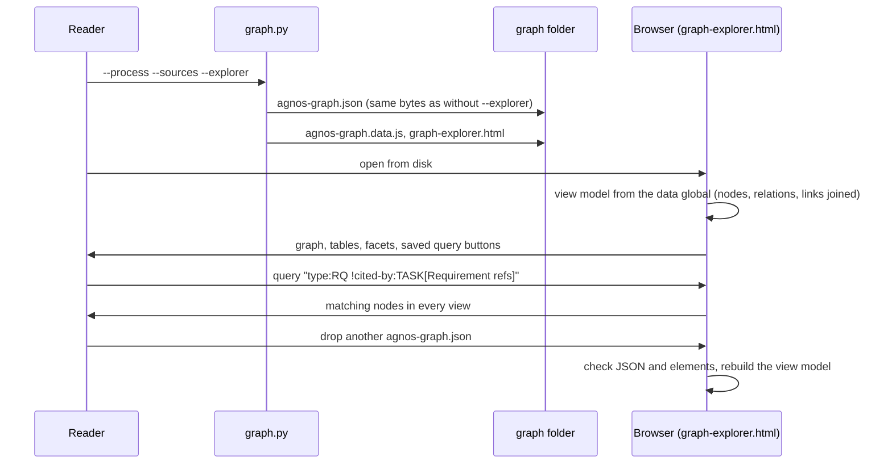

# ADR-TRC-025: Graph explorer page

## Status
Proposed — for FTR-TRC-014 (RQ-TRC-142 to RQ-TRC-158). Amends DEC-TRC-077 (the graph path) and DEC-TRC-054 (the names of the performance center's outputs); extends ADR-TRC-022 (the graph skill, DEC-TRC-074) and applies ADR-TRC-002 (the design system, DEC-TRC-009, DEC-TRC-010) to a second page.

## Context
FTR-TRC-014: the owner explores `agnos-graph.json` before deciding what the performance center reads of its `links` block.
The graph skill writes one sorted JSON file (DEC-TRC-074); the performance center's page is assembled by `perf_center.py`
from `assets/matrix.*` and `tokens.json`, with markers replaced, loads Cytoscape.js and ECharts from cdnjs with their
integrity (DEC-TRC-040), and reads its data from a `.data.js` script because a page opened from the disk fetches no file
(RQ-TRC-010). Its splitters (DEC-TRC-012) and its wheel zoom (DEC-TRC-031) are set by tokens; its graph nodes cannot be
dragged (`autoungrabify`). Its type colours are the Okabe-Ito tokens `type-ftr` to `type-task`, fit for surfaces but under
4.5:1 as text on white for RQ, DEC, PLAN and ADR. The owner chose to keep the two pages apart at first (option A).

## Decision

### DEC-TRC-084: Explorer assets owned by the graph skill
- **Statement**: The graph skill SHALL hold the explorer's template, script, style, tokens and default queries under `assets/explorer/`, and `graph.py` SHALL assemble them into one page by replacing markers, as `perf_center.py` does, copying the values of the performance center's tokens it needs rather than reading its files.
- **Rationale**: the explorer shows the graph and nothing the performance center computes, so it lives with the file it shows; no skill reads another's assets, which keeps each self-contained (DEC-PLG-027); the copy is the owner's option A, to be merged later.
- **Requirement refs**: RQ-TRC-144, RQ-TRC-146, RQ-TRC-155
- **Dependencies**: DEC-TRC-074, DEC-TRC-009

### DEC-TRC-085: Explorer flag of the graph script
- **Statement**: `graph.py` SHALL write `graph-explorer.html` and `agnos-graph.data.js` beside the graph file only when `--explorer` is given, after writing the graph file unchanged, and `agnos-perf-center` SHALL keep invoking it without that flag.
- **Rationale**: the explorer is a goal of its own (owner, 2026-11-22); writing it after the graph leaves the graph's bytes as they are (RQ-TRC-156), and the subprocess of DEC-TRC-076 needs no change.
- **Requirement refs**: RQ-TRC-144, RQ-TRC-156
- **Dependencies**: DEC-TRC-076, DEC-TRC-084

### DEC-TRC-086: Graph folder declared in the layout
- **Statement**: `layout.json` SHALL declare `graphFile` as `4.knowledge/graph/agnos-graph.json`, the explorer files SHALL be written in that file's folder, and every skill SHALL read the path from its generated layout copy.
- **Rationale**: the path stays one name written once (RQ-PLG-036), and the graph's folder holds its explorer. Amends DEC-TRC-077.
- **Requirement refs**: RQ-TRC-142
- **Dependencies**: DEC-TRC-077

### DEC-TRC-087: Lowercase performance center outputs
- **Statement**: `layout.json` SHALL declare `perfCenterPage` as `perf-center.html`, and the performance center SHALL name its data files from that page's stem, `perf-center.json` and `perf-center.data.js`.
- **Rationale**: both pages carry lowercase names (owner, 2026-11-22); the data files keep following the page as before. Amends DEC-TRC-054; DEC-TRC-055 applies: plans and `CHANGELOG.md` keep the former names, features and ADRs are aligned with a dated comment.
- **Requirement refs**: RQ-TRC-143
- **Dependencies**: DEC-TRC-054, DEC-TRC-055

### DEC-TRC-088: Graph data script with file drop
- **Statement**: The explorer SHALL read the graph from a global set by `agnos-graph.data.js`, and SHALL read a dropped or chosen file with the browser's `FileReader`, checking that it is JSON with an `elements` list before replacing the shown graph.
- **Rationale**: a page opened from the disk fetches no file (RQ-TRC-010); a local file read by the reader's own action needs no server.
- **Requirement refs**: RQ-TRC-145
- **Dependencies**: DEC-TRC-085

### DEC-TRC-089: View model joined from every block
- **Statement**: The explorer SHALL build one view model of nodes (elements, sections, files, functions) and relations (edges, calls), giving each `refs` proof the field of the `links` row of the same source, target and line, and attaching `tasks`, `history` and `delivery` to their nodes as properties.
- **Rationale**: one model feeds the graph, the tables, the facets and the query, so every view shows the same thing; the join follows the format of `links` (DEC-TRC-081).
- **Requirement refs**: RQ-TRC-146, RQ-TRC-151
- **Dependencies**: DEC-TRC-081, DEC-TRC-078

### DEC-TRC-090: Cytoscape graph with draggable nodes
- **Statement**: The explorer's graph view SHALL use Cytoscape.js from cdnjs with its integrity, as the performance center records it, with grabbable nodes, the zoom bounds and wheel sensitivity of the copied tokens, and SHALL keep the positions of moved nodes in the view model when the filters change.
- **Rationale**: the gestures and the library are those the owner knows from the performance center (DEC-TRC-031, DEC-TRC-040); positions kept in the model survive a redraw.
- **Requirement refs**: RQ-TRC-150, RQ-TRC-158
- **Dependencies**: DEC-TRC-040, DEC-TRC-031, DEC-TRC-084

### DEC-TRC-091: Text tokens per node type
- **Statement**: The explorer's tokens SHALL add one `type-*-text` semantic token per node type, a darker shade of its type's hue reaching 4.5:1 on the page and panel backgrounds, used for type labels, while `type-*` stays the surface colour of nodes and swatches.
- **Rationale**: the Okabe-Ito hues keep the identity of the performance center's types, and a darker shade of each makes its text readable on white (RQ-TRC-157); the design system holds the values, never the code (DEC-TRC-010).
- **Requirement refs**: RQ-TRC-147, RQ-TRC-157
- **Dependencies**: DEC-TRC-009, DEC-TRC-010

### DEC-TRC-092: Hand-written term query parser
- **Statement**: The explorer SHALL parse its query with a hand-written parser of space-separated terms, `key:value`, `key:a,b`, `key:!value`, `key:~text`, `cites:TYPE[field]`, `cited-by:TYPE[field]`, each negatable by `!`, and a leading `edge` keyword for relation queries, reporting the first term that does not parse.
- **Rationale**: the grammar reads like the facets and fits in a short module with no library; a query engine such as Cypher would be harder to read (owner, 2026-11-22).
- **Requirement refs**: RQ-TRC-152, RQ-TRC-155
- **Dependencies**: DEC-TRC-089

### DEC-TRC-093: Saved queries in browser storage
- **Statement**: The explorer SHALL keep the saved query buttons in `localStorage` as an ordered list of label and query, seeded from `assets/explorer/presets.json` when the store is empty, and SHALL export and import that list as a JSON file.
- **Rationale**: the buttons are the reader's own and need no server; the JSON file carries them to another browser or project.
- **Requirement refs**: RQ-TRC-153
- **Dependencies**: DEC-TRC-092

## Consequences
- Easier: a reader opens one page and studies the whole state of a project, its declared links and its mentions apart.
- Harder: the splitter, zoom and token values exist twice, in both skills, until they are merged; a change of the graph format
  is followed in the explorer's view model.
- Constrained: the explorer needs the network for Cytoscape.js, as the performance center does; saved queries stay in one
  browser unless exported; existing projects keep their former `4.knowledge/agnos-graph.json` and `PERF-CENTER.*` files, as
  generated files, and update their ignore rules.

## Alternatives Considered
- **A user interface kit shared by both skills (option B)**: no copy, but the performance center, its pinned tests, the demo
  and the release change with it. Postponed by the owner (2026-11-22).
- **Explorer written at every graph run**: simpler, but the performance center would write a page it does not need.
  Rejected (owner, 2026-11-22).
- **Neo4j, Cytoscape Desktop or Gephi fed by a converter**: rich, but an installation, a conversion and no knowledge of the
  `links` join. Rejected (owner, 2026-11-22).
- **A Cypher-like query language**: expressive, but harder to read and to write than terms. Rejected (owner, 2026-11-22).

## Diagram

