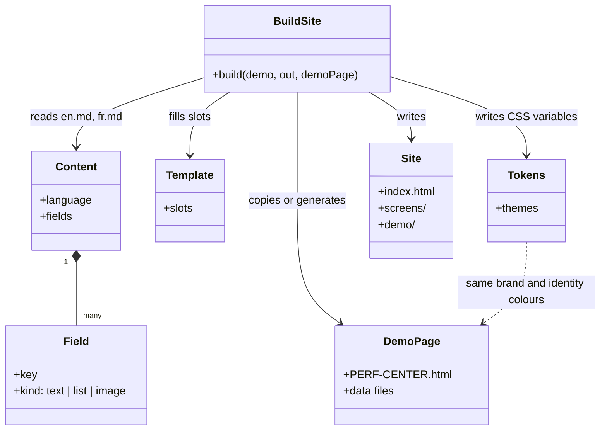
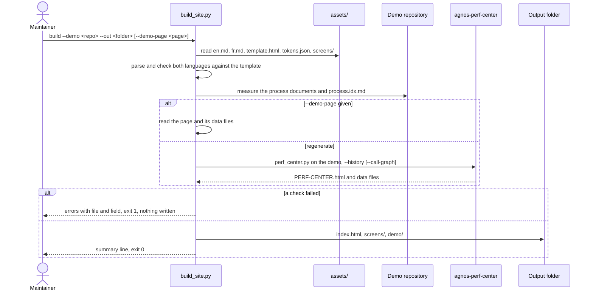

# ADR-WEB-001: A Maintainer Skill That Assembles the Site From Markdown, Images and the Demo Page

## Status
Accepted — approved by the owner on 2026-11-08, for FTR-WEB-001 (RQ-WEB-001 to RQ-WEB-016); RQ-WEB-017, the examples, added on 2026-11-08 under the same decisions. DEC-WEB-007 approved by the owner on 2026-11-12 for RQ-WEB-019.

## Context
The presentation website must follow AGNOS's evolutions, in English and French, with visuals continuous with the Performance Center.
The mock-up of 2026-11-08 (a prototype under `site.tmp/`, outside the process) proved the approach: Markdown content per language, a
template without text, screenshots linking to the demo, a chain card, one page with a language switch, 105 fields per language. The demo
Performance Center page is produced by `agnos-perf-center` on `agnos-lightweight-process.demo`, which `agnos-meta-demo` builds.

## Decision

### DEC-WEB-001: A Python maintainer skill, `agnos-meta-website`
`.github/skills/agnos-meta-website/` holds `SKILL.md`, `scripts/build_site.py` (standard library only, as `agnos-perf-center`), `tests/`
and `assets/`; `.claude/skills/agnos-meta-website/SKILL.md` points to it. One sub-command, `build --demo <repository> --out <folder>
[--demo-page <page>]`. The build checks everything in memory first and writes only when nothing failed. Fulfils RQ-WEB-001, RQ-WEB-016.

### DEC-WEB-002: The demo page, copied or generated
With `--demo-page`, the page and its data files (`PERF-CENTER.json`, `PERF-CENTER.data.js`) are copied into `demo/`. Without it, the
build runs this working tree's `perf_center.py` on the demo with `--process agnos-process --sources service --sources client --history
--call-graph`, the same sources as `agnos-meta-demo verify`; the generator itself leaves the functions out when the call-graph packages
are missing. `--demo` stays required. Fulfils RQ-WEB-002. Amended on 2026-11-13 (TASK-WEB-017): the index figures, measured on the
demo for RQ-WEB-005, are removed with that requirement.

### DEC-WEB-003: Content in `assets/content/`, images in `assets/screens/`, a template without text
`en.md` and `fr.md` follow the mock-up's format: `##` section, `###` field, paragraph, list or linked image. `assets/template.html` names
each field by a `data-i18n` attribute on an empty element, and the build fills it. The English text goes into the markup; the French
text into a JSON dictionary in the page, applied in place by a small script that remembers the choice in `localStorage`. Fulfils
RQ-WEB-003, RQ-WEB-004, RQ-WEB-006, RQ-WEB-007.

### DEC-WEB-004: Screenshots, not redrawn views
Each tour stop shows a PNG of the real view, linking to the demo. No chart library: a second rendering would drift from the Performance
Center. Until the owner takes the screenshots, the assets hold one placeholder per view, a single colour at 16:10, written once by the
task that creates the assets; their capture stays manual. Fulfils RQ-WEB-011, RQ-WEB-012.

### DEC-WEB-005: The site's design system extends the Performance Center's
This repository has one design system, the Performance Center's (RQ-TRC-018, ADR-TRC-002), and `agnos-design-system` keeps a single one
per project. So the site's `assets/tokens.json` is a layer over `agnos-perf-center/assets/tokens.json`, in the same three tiers
(global, semantic, component): its semantic tokens may refer to the Performance Center's global tokens, and none of its names repeats
one of them. The brand, identity and grade colours are therefore the Performance Center's own tokens; the layout, type and band values
are the site's. The build writes as CSS custom properties, for each theme, the tokens the template refers to (`--s-<name>`,
`--c-<name>`); the template's style uses only `var(--…)`, and `{{t:<name>}}` where CSS cannot read a variable (media queries). Fulfils
RQ-WEB-008, RQ-WEB-014, RQ-WEB-015.

### DEC-WEB-006: The build writes a folder; publishing stays with the owner
`--out` is typically the owner's working copy of `spashx/agnos.site`. The build replaces `index.html`, `screens/` and `demo/` there and
touches nothing else; it never commits nor pushes. Fulfils RQ-WEB-001, RQ-WEB-013.

### DEC-WEB-007: A ratio token for the screenshot frames, checked at build
Added on 2026-11-12 for RQ-WEB-019. The site's `assets/tokens.json` gains `web.ratio-shot`, `1291 / 720`, consumed by the tour and
example frames in place of the literal `16/10`. `build_site.py` reads each PNG's width and height from its `IHDR` header (standard
library), and fails when the ratio is off by more than 0.5% or the width is below 1291 px; the placeholders of DEC-WEB-004 are
rewritten at 1936 × 1080. Fulfils RQ-WEB-019, RQ-WEB-012.

## Consequences
- The owner edits text and images in `assets/` and rebuilds; no page code to touch.
- The site cannot open the demo on a given view until the Performance Center supports it; screenshots open the page, or an element.
- Screenshots go stale when the Performance Center changes, until the owner retakes them.
- A rebuild without `--demo-page` needs the demo built and Python packages for the call graph, as `agnos-meta-demo` does.

## Alternatives Considered
- **Redrawing the views with ECharts from the demo's data**: tried in the mock-up's second version; drifts from the real views. Rejected.
- **One page per language (`/` and `/fr/`)**: two addresses to share and keep aligned; kept possible later, since the content already
  splits by language. Not chosen now.
- **Automatic screenshots with a headless browser**: produced nothing in the session's sandbox on 2026-11-08; the owner replaces the
  images by hand. Deferred.
- **A static site generator (Jekyll, Hugo)**: a new dependency for one page. Rejected.
- **The text inside the template**: the owner would edit HTML. Rejected.

## Diagram

