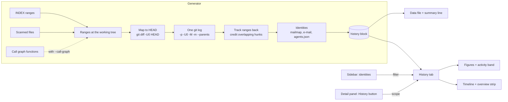

# ADR-HST-001: Contribution History — Line Tracking over Git, Merged Identities, and a Timeline View

## Status
Accepted — approved by the owner on 2026-10-24; owner request of 2026-10-24 (a history of who worked on the requirements and on the code, humans and agents
told apart, in a new History tab of the traceability page), reformulated as FTR-HST-001 (RQ-HST-001 to RQ-HST-015).
Extends the generator of ADR-TRC-001 and the page of ADR-TRC-003, with the tokens and tiers of ADR-TRC-002; follows the
opt-in pattern of the call graph (ADR-TRC-004, DEC-TRC-013).

## Context
The generator knows, for each process element, its file and line range (`INDEX.idx.md`), for each scanned file the IDs
its lines cite, and, with a call graph, each function's range and the IDs it cites (DEC-TRC-016). The history must
credit a commit to an element only when it changed that element's lines (RQ-HST-002), and to a function only when it
changed that function's lines (RQ-HST-003): those ranges are known at the working tree, not at the time of each commit,
so they must be carried back through every earlier version, across renames and merges. The generator is standard
library only (RQ-TRC-021) and must stay so (RQ-HST-015); the page is one offline file whose only library is the graph's
(ADR-TRC-003). A project may hold thousands of commits and, with a call graph, tens of thousands of functions
(RQ-TRC-037), so one git process per element is out of the question (RQ-HST-013). Identities come from free-form git
data: a person has several names, a hosting service commits merges, agents appear only as `Co-Authored-By` trailers
(RQ-HST-004, RQ-HST-005).

## Decision

### DEC-HST-001: A history module loaded only with `--history`, reading git through its command line
A new script, `scripts/history.py`, beside the generator, is loaded by `trace_matrix.py` only when `--history` is given,
as `callgraph.py` is (DEC-TRC-013). It runs the `git` command with `subprocess`, never a git library, and reads its text
output: the history needs nothing beyond the standard library and git (RQ-HST-015). `--history-since` and
`--history-depth` are passed to git as `--since` and `--max-count`, so git applies both and the stricter one decides;
given without `--history`, they are an input error (exit code 1). The module first checks git (`git --version`), the
working tree (`git rev-parse --show-toplevel` from the process folder), a first commit and a shallow clone
(`git rev-parse --is-shallow-repository`); a failure is a warning and the page is built without history (RQ-HST-012).
Fulfils RQ-HST-001, RQ-HST-012 and RQ-HST-015.

### DEC-HST-002: Line ranges tracked back over the commit graph, from one `git log`
The ranges to follow are known at the working tree: each process element's lines, each scanned file whole, and each
function's lines with a call graph. The module maps them first to the last commit's coordinates through the
uncommitted changes (`git diff -U0 HEAD`), which credit no one. It then reads one `git log` over the process and
source folders, newest first in topological order, with each commit's parents, author, author date, trailers and its
zero-context diff against each parent with renames detected (`-p -U0 -M -m --parents --topo-order`). Walking that
output, it keeps the ranges of each path at each commit; for each commit and parent, a hunk whose new side overlaps a
tracked range credits the commit with an intervention on that range, with its number of changed lines, and the ranges
are then shifted through the hunks to the parent's coordinates (the file's old name after a rename). A merge commit
credits no one: its ranges are only carried to each parent. This is what `git log -L` does, for every range at once in
one process. A range whose lines were all added by a commit stops at that commit. Fulfils RQ-HST-002 and RQ-HST-003.

### DEC-HST-003: Identities by author, e-mail and `.mailmap`; agents by patterns of a data file
The author is read with `%aN` and `%aE`, to which git applies the repository's `.mailmap`; the committer is never read.
Co-authors are read from the `Co-Authored-By` trailers (ignoring case) and mapped the same way. Human contributors
sharing an e-mail address (ignoring case) are one identity; an agent is one name and e-mail address, since the models of
one vendor share a no-reply address (Claude Opus 5.5 and Claude Sonnet 5.5 both commit as `noreply@anthropic.com`). An
identity's display name is its most frequent name; it keeps all its names
and addresses and how they were merged (`email`, `mailmap`). A data file of the skill, `assets/agents.json`, lists
patterns (regular expressions on the name and on the e-mail) of AI assistants and bots (for example
`noreply@anthropic\.com`, `^claude\b`, `copilot`, `\[bot\]$`); an identity matching one is an agent, any other is a human.
A commit is `human`, `agent` or `together` from the kinds of its contributors. Changing the patterns changes no code.
Fulfils RQ-HST-004 and RQ-HST-005.

### DEC-HST-004: A compact, sorted `history` block in the data file
The block holds `limits` (since, depth, commits read, first and last dates, shallow), `people` (an array: display name,
names, e-mails, merged-by, kind, commits as author, commits as co-author), `commits` (an array in date order: short hash,
author date in ISO 8601, author index, co-author indexes, kind, subject) and `interventions`, keyed by element ID, by
file path and, with a call graph, by function index of the `callGraph` block, each a list of `[commit index, changed
lines]`. Indexes instead of repeated strings keep the size within RQ-HST-013. Every list is sorted, so that two runs
write the same bytes (RQ-TRC-023). The summary line gains `history: <commits> commits, <humans> humans, <agents>
agents`. Without `--history` there is no `history` key and the RQ-TRC-026 sentinel is unchanged. The page computes no
intervention; it only filters and draws. Fulfils RQ-HST-006 and RQ-HST-015.

### DEC-HST-005: The timeline is inline SVG drawn by the page script, rows virtualised
The History view is drawn by the page script with no new library: a header of key figures, an activity band (stacked
bars per day, week or month, chosen from the visible time span), and the timeline, a grid of rows (labels on the left,
marks on a time scale) with an overview strip below whose window is the visible span. Only the rows in view are in the
document, so that thousands of rows redraw in less than 50 ms (RQ-HST-013). A mark's shape tells the kind (circle:
human; diamond: agent; ringed circle: together, the ring in the co-author's colour), its colour the author, and its
radius the changed lines on a square-root scale bounded by two tokens. Each identity has a colour of its own (owner
amendment of 2026-10-24): the first twelve, by number of commits, take a categorical set of twelve global tokens; the
next ones take a hue turned by the golden angle at the lightness and chroma given by tokens, so that every colour is
distinct and still comes from the design system. The colour is computed once per identity and used by the marks, the
legend, the filter chips and the sidebar. Beside every identity's name, an inline SVG icon tells its kind (a person
for a human, an agent glyph for an agent), drawn with the page's icon tokens. The wheel zooms around the pointer with the page's wheel-sensitivity token;
dragging or the arrow keys pan; `+`, `-` and `0` zoom and fit. Hover raises the page's tooltip after its token delay;
click pins a commit card. All visual values are tokens of ADR-TRC-002, new ones added in its tiers. Fulfils RQ-HST-007,
RQ-HST-008 and RQ-HST-014.

### DEC-HST-006: One view state, three entry points
The view's state is one object: angle (`requirements` or `code`), code grouping (`files` or `requirements`), the
selected identities, the kind, the scope (an element ID, a file or a function, or none), the visible time span, and
whether empty rows show. The History tab, the sidebar's History section (identities by commits, a tooltip listing the
merged names and e-mails, a click that sets the identities to that one and opens the tab) and the detail panel's History
button (which sets the scope: a process element and the elements it contains, or a file and its functions; the code
angle shows the code citing the scope) all write this state and redraw the view; the scope shows as a removable chip.
Fulfils RQ-HST-009, RQ-HST-010 and RQ-HST-011.

### DEC-HST-007: One rich tooltip component for business information; the browser's title for actions only
Owner request of 2026-10-24 (FTR-HST-002). The page gets one tooltip component, a fixed card at the page's level (not
inside a view, so that the sidebar can raise it), with a bold first line and detail lines, the card tokens, the
tooltip delay token on hover and none on focus, placed beside its target and kept inside the window. Every business
tooltip of RQ-HST-017 goes through it, the search's, the charts' and the History tab's included, which keep their
content and lose their own code. A plain `title` stays only on controls, to say what they do, and is removed from every
element that raises a rich tooltip and from its containers: the charts' accessible name moves from an SVG `<title>` to
`aria-label`, with the description kept in `<desc>`; the timeline frame's help moves to the legend. The graph's nodes
and relations raise it from Cytoscape's events. The page's wording holds no ID of the skill's process (RQ-HST-018),
checked by a test on the script's string literals and the skeleton's text. Fulfils RQ-HST-016 to RQ-HST-018 and the
amended RQ-HST-010 and RQ-HST-014.

### DEC-HST-008: Files in a folder tree, a resizable label column, a filter on the rows
Owner request of 2026-10-24. In the code angle by file, the rows are built as a tree of the files' folders: a folder row
per path part, carrying the merged interventions of everything below it, opened by default and opened or closed by a
click or the Enter key (the closed folders are a set of paths in the view's state, so that a redraw keeps them); a file
row under its folder by its file name; its functions below it. The label column's width is a custom property of the
view, set by a splitter between the labels and the timeline, as the page's side panels are (DEC-TRC-012): drag and
arrow keys by a step token, bounds from min and max tokens, a double click back to the default token, the width kept in
the viewer's storage; the axis, band and overview rows use the same property, so that they stay aligned. A text field
and type chips filter the rows before the identity and kind filters: a row stays when its ID, title, path or function
name holds the text (ignoring case), and a heading or folder stays when a row below it stays. Fulfils RQ-HST-019 to
RQ-HST-021.

## Consequences
- The attribution is per line, as precise as `git log -L`, for all ranges in one git process; its cost grows with the
  size of the diffs read, bounded by `--history-since` and `--history-depth`.
- The ranges are those of the working tree: an element defined today is followed back through its earlier versions,
  but an element deleted before today has no row.
- git becomes a runtime need of the generator with `--history` only; without it nothing changes.
- The agent patterns are the skill's; a project with another assistant edits the data file, and a command-line option
  for it stays out of scope.
- The page grows by the view's code in every case, and by the history data only when it is built.
- E-mail addresses of contributors appear in the page's tooltips, as they do in the repository itself.

## Alternatives Considered
- **`git log -L` once per range**: exact, but one process per element or function; tens of thousands of processes on
  a large project. Rejected.
- **`git blame` of the working tree**: one process per file, but it gives the last author of each line only, not who
  worked on it over time. Rejected.
- **Commits per file only**: cheap, but a feature file holds many requirements, and everyone who touched one would be
  credited with all. Rejected for process elements; kept for files in the code angle.
- **A git library (GitPython, pygit2, PyDriller)**: a dependency outside the standard library (RQ-TRC-021). Rejected.
- **Committer instead of author**: credits the person or service that rebased or merged. Rejected (RQ-HST-004).
- **A timeline library (vis-timeline, D3)**: hundreds of kilobytes in an offline page for one view, and its styles
  outside the tokens. Rejected.
- **Canvas instead of SVG**: faster for millions of marks, but no focusable marks and no accessible names
  (RQ-HST-014); row virtualisation keeps SVG within the time budget. Rejected.

## Diagram

