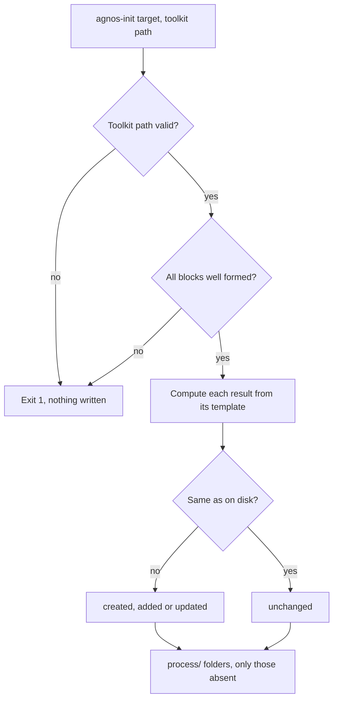

# ADR-INI-001: A Scripted Block in the Project's Entry-Point Files

## Status
Accepted — approved by the owner on 2026-10-31, for FTR-INI-001 (RQ-INI-001 to RQ-INI-009). Amends DEC-MTA-005 and DEC-MTA-006 of ADR-MTA-001.

## Context
Projects will not hold the toolkit (DEC-MTA-006), and agents read `CLAUDE.md` or `AGENTS.md` to know about AGNOS. Many repositories
already have these files. The owner wants no non-deterministic behaviour, and a required call stated clearly. An uninitialised
project does not load the instructions file, so a rule written only there is never read. A project also discovers no skill of
the toolkit, whose `SKILL.md` procedures give paths from the toolkit's root.

## Decision

### DEC-INI-001: An explicit call, done by a script
`agnos-init` is called explicitly, and scripts do all its work, from templates, in PowerShell 5.1 and bash like `agnos-index`. No
`SessionStart` hook: what it injects depends on the harness, and it would hide the step. Fulfils RQ-INI-001.

### DEC-INI-002: One delimited block, every other byte preserved
AGNOS owns only the lines between its markers. Files are handled as bytes, so encoding and existing line endings survive; the
block takes the ending of the file's first line. The whole call is checked before any write, so a damaged block changes nothing.
Writes happen only on a change. Fulfils RQ-INI-002, RQ-INI-003, RQ-INI-004.

### DEC-INI-003: One template per entry-point file
`assets/templates/CLAUDE.block.md` imports the instructions with `@`, and `AGENTS.block.md` tells the agent what to read, since
`AGENTS.md` has no standard import. Only `{{TOOLKIT}}` is replaced. Templates hold no ID, because they are delivered as they are:
their traceability is in the scripts and `SKILL.md`. Fulfils RQ-INI-006. Its import is replaced by DEC-INI-007 (amended on 2026-10-31).

### DEC-INI-004: The toolkit path is an input, written as given
The path is mandatory, relative to the target, and written with `/`; the script does not compute one. A relative path works in each
clone with the same layout, and keeps the demo's commit IDs stable. Fulfils RQ-INI-001, RQ-INI-006, RQ-INI-008.

### DEC-INI-005: The plugin comes after, and only supplies the path
This adjusts DEC-MTA-005: `agnos-init` comes first and needs no plugin. The plugin target will give it the path of its installed
files, which remains to be designed. This also adjusts DEC-MTA-006: the demo holds the two files with the block, and can run a session.
Fulfils RQ-INI-008.

### DEC-INI-006: The call is stated in three places
For a human, `README.md` and `GETTING_STARTED.MD`. For an agent with the instructions loaded, START SESSION. For every case, the error
of `agnos-index`, which is a script and so holds whatever the agent read. Fulfils RQ-INI-007.

### DEC-INI-007: An order to read, no external import
Both templates order the agent, before any other action, to read the instructions file and run START SESSION. Claude Code loads an external `@` import only after an approval, and when it is not loaded the session gets no error. On 2026-10-31 a session in the demo started with the `@` line and not the file's content; the owner recalls no dialog, which is unconfirmed, and the terminal was not tested. An order stays visible whatever happens to an import. Amends DEC-INI-003. Fulfils RQ-INI-010.

## Consequences
- The rules reach the agent through its first read, not at load: the order still has to be followed, and a session test checks it.
- The plugin target (DEC-INI-005) keeps this order, since its files also lie outside the project. Its installed path may differ per machine and version, while the block is committed: that remains to be designed with it.
- A developer keeps their files, and an update of AGNOS is one more call changing the block only.
- Two scripts must stay byte-equivalent, so one test suite runs both on the same cases.
- The block's path holds only for clones with the same relative layout; another layout calls `agnos-init` with its own path, which shows in the diff.
- `agnos-index`'s error text changes, with its requirement and tests in both versions.
- The project's own rules and AGNOS's may contradict each other in one file; START SESSION step 7 reports it.

## Alternatives Considered
- **A `SessionStart` hook**: no file to write, but tied to one harness and invisible. Rejected.
- **Creating the files and refusing existing ones**: simple, but blocks every repository that already has a `CLAUDE.md`. Rejected.
- **A separate `AGNOS.md` imported by the project**: the entry-point files still need editing, and agents without imports never read it. Rejected.
- **Python**: one implementation, but the first command of a project would need an interpreter that `agnos-index` does not require. Rejected.
- **An absolute toolkit path by default**: nothing to pass, but it breaks in each other clone and changes the demo's commit IDs per machine. Rejected.

## Diagram

