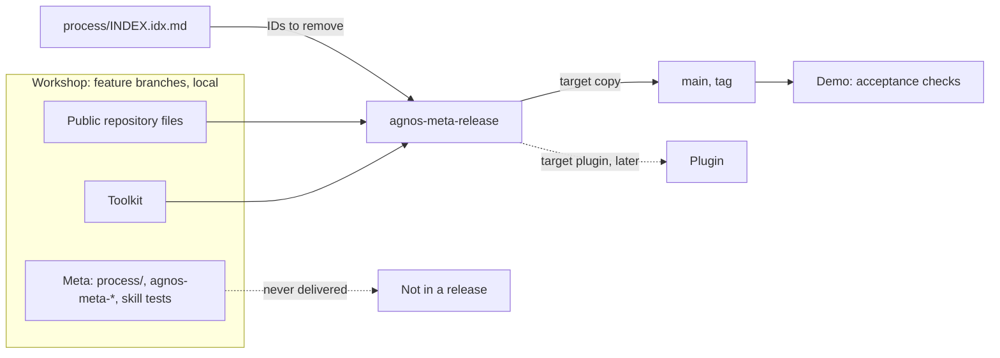

# ADR-MTA-001: One Repository, Three Layers, a Release Built from the Workshop

## Status
Accepted — approved by the owner on 2026-10-31, for FTR-MTA-001 (RQ-MTA-001 to RQ-MTA-004). Amends DEC-DMO-006 (the
generator's name); the docs-sync report's maintainer flag of RQ-DOC-001 keeps its meaning and changes its criterion.

## Context
AGNOS develops itself with itself, so the toolkit has to stay where agents discover it, at the root of the repository, beside
the artifacts of its own development. Delivery has been manual: delete `process/`, remove IDs. Release 3.1 had about 90 lines
citing an ID, most of them examples; the tree now holds 981 citations of artifacts that are really defined, plus 113 of example
IDs that must stay. Tests of the skills are 47 of the 78 skill files copied into the demo.

The local `dev` branch shows the cost: its 5 commits absent from `feature/TRC` delete the IDX specifications and strip IDs by
hand. Compared with `feature/TRC` they hold nothing to recover but a one-line `REQ.README.MD`. `feature/TRC` already has a
stronger wording of the only rule they changed.

## Decision

### DEC-MTA-001: One repository, the toolkit at its root
The toolkit stays at the root, used as it is by the development of AGNOS. A second repository could come later by changing where
a release is written. Fulfils RQ-MTA-001.

### DEC-MTA-002: Three layers
**Toolkit**: the instructions, `CLAUDE.md`, `AGENTS.md`, the process skills, `README.md`, `GETTING_STARTED.MD`, `CHANGELOG.md`.
**Public repository**: `LICENSE.md`, `SECURITY.md`, `CODE_OF_CONDUCT.md`, `CONTRIBUTING.md`, the GitHub templates.
**Meta**: `process/` with its generated index and session files, the `agnos-meta-*` skills and sub-agents, and the tests of every
skill, which keep running in the workshop and are not delivered. A project generates its own `process/INDEX.idx.md`.
`CONTRIBUTING.md` states this, so the generic instructions and their line budget do not change. Fulfils RQ-MTA-004.

### DEC-MTA-003: The prefix `agnos-meta-` is the only criterion
Skills, pointers and sub-agents take the prefix (`agnos-meta-demo`, `agnos-meta-docs-sync`). The report's `MAINTAINER_MARK`, the
demo's `baselineExclude` entries and `MAINTAINER_PATTERN` read the prefix. Internal names of the generated demo stay: the
`.git/agnos-demo-*` files, the verify folder prefix and the `@agnos-demo.example` addresses. Closed plans and released changelog
sections keep the old names as history. Fulfils RQ-MTA-001, RQ-MTA-002, RQ-MTA-003.

### DEC-MTA-004: A release is the output of a build
A future skill, `agnos-meta-release`, selects the delivered layers, removes the IDs found in the workshop's index and leaves
examples alone, fails on any defined ID left, and takes a target from the start (`copy` first). Each release then lands on `main`
as a snapshot, with no merge from the workshop, and the demo's acceptance checks validate it. `dev`'s hand-cleaning commits are not
merged into the workshop. **Everything stays local until the owner lifts this**: no push, and `feature/TRC` remains the
integration branch of this work. Its requirements come in a later feature.

### DEC-MTA-005: A plugin is a further target, after the first clean release
The same build gets a `plugin` target, and the copy format stays for agents without plugins. It needs a process skill, `agnos-init`,
because a plugin's `CLAUDE.md` is not loaded and AGNOS needs its rules in every session; `SKILL.md` paths rewritten to the plugin
root by the build; and no repository of its own at first. Its requirements come in a later feature.

## Consequences
- A third meta skill needs its name only; no list has to change.
- `agnos-meta-demo build` and `verify` are one rename away from any stale reference, so the demo is rebuilt in the task that renames.
- The prefix says nothing about the tests of the process skills: the release has to exclude them by path.
- Commands written in closed plans keep the old names and no longer run as written.
- `dev` and `origin/dev` remain behind and divergent until a publishing decision is made; that decision will need a history rewrite or a new branch name.

## Alternatives Considered
- **Two repositories now**: a cleaner boundary, but the same build is needed, and the workshop still needs the toolkit at its root. Postponed.
- **Sources in `toolkit/`, synchronised to the root**: moves 199 files and leaves AGNOS developing itself with a stale copy unless each edit syncs. Rejected.
- **A folder for meta skills**: agents would not discover them. Rejected.
- **Delivering with the IDs**: simplest, but a project's `grep` would hit them, sometimes with its own trigrams. Rejected.
- **The maintainer mark in the description**: already used, but free text, and neither the demo nor the reader of a folder sees it. Rejected.

## Diagram

