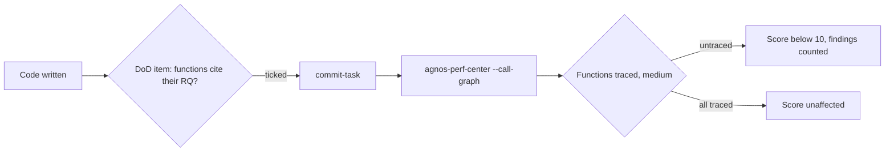

# ADR-PLG-004: Function Traceability Counts, and is Asked for Plainly

## Status
Accepted — approved by the owner on 2026-11-05, for FTR-PLG-004 (RQ-PLG-024, RQ-PLG-025). Amends DEC-TRC-032 on the risk of "Functions traced", and RQ-TRC-035, RQ-TRC-059.

## Context
FTR-PLG-004 (RQ-PLG-024, RQ-PLG-025) comes from the owner's session of 2026-11-05 in Copilot in VS Code. The process requires
"traceable references to the requirement ID(s) ... in the form of comments or docstrings" for code, but its Definition of Done names
only "every new artifact". The perf center scores untraced functions as informational (DEC-TRC-032, RQ-TRC-035: "not an AGNOS rule
breach"), so the session's three untraced functions left it graded A 10/10. The perf center already reads a function's IDs both in its
lines, docstring included, and in the comment block just above it, so Python's docstrings are not at stake.

## Decision

### DEC-PLG-019: "Functions traced" is a medium-risk check
`assets/scoring.json` gives the check the risk medium, the weight of "Files traced". Its findings join the findings total. Without
`--call-graph` the check has no population, hence no score, and weighs nothing, as every check with no population does. The page reads
the check's risk from the data, so no label says "informational" in the code; `references/rules.md` states the new level. Fulfils
RQ-PLG-024; amends DEC-TRC-032, RQ-TRC-035 and RQ-TRC-059 on that check.

### DEC-PLG-020: One DoD line for functions
The DoD matrix gains, for S, M and L, "Every new function, method and class cites its requirement ID in its doc comment or in the
comment just above it", the two places the perf center reads. Fulfils RQ-PLG-025.

## Consequences
- Easier: the grade tells the truth about functions; an agent checking the DoD sees the rule as an item to tick.
- Harder: projects analysed with `--call-graph` see their score drop until their functions cite IDs.
- Constrained: the score of a project depends on whether `--call-graph` ran; the check says "n/a" when it did not.

## Alternatives Considered
- **Weight low (2.5) or high (7.5)**: the owner chose medium on 2026-11-05, as files: a function untraced weighs as a file untraced.
- **The perf center run before each commit**: detects with a tool rather than the model's memory, about a second per task. Not
  chosen by the owner on 2026-11-05.
- **A new rule in the code section only**: the rule exists there already; the checklist is what an agent ticks. Rejected.
- **Choosing the model**: outside the plugin's reach; a test with a chosen model was not asked. Rejected for now.

## Diagram

