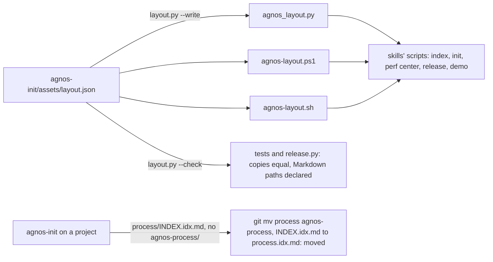

# ADR-PLG-006: The Process Folder is `agnos-process/`, Its Index `process.idx.md`, Named Once

## Status
Proposed — for FTR-PLG-006 (RQ-PLG-034 to RQ-PLG-038). Choices of the owner on 2026-11-06: the name `agnos-process/`, the generated
skill renamed, migration by `git mv`, one JSON source with generated copies, this plan before PLAN-PLG-005, the index named `process.idx.md`.

## Context
FTR-PLG-006: the folder's name and those of its subfolders and files are written out in 62 tracked files, in Python, PowerShell,
POSIX bash (no `jq`), JavaScript and Markdown. Each delivered skill runs from its own folder, in this repository
(`.github/skills/<name>/`) as in the plugin (`plugins/agnos/skills/<name>/`); a skill reading another's folder at run time would tie
the skills together. The release already proves that the delivered tree behaves as the repository does (RQ-MTA-006).

## Decision

### DEC-PLG-027: `layout.json` is the source, each skill holds a generated copy
`.github/skills/agnos-init/assets/layout.json` declares `folder`, `subfolders`, `index`, `sessionState`, `metricsLog` and
`folderReadme`, as relative paths. `layout.py --write` generates, into each skill that needs them, `scripts/agnos_layout.py`,
`scripts/agnos-layout.ps1` (dot-sourced) and `scripts/agnos-layout.sh` (sourced), only the languages that skill uses, each starting
with a line saying it is generated. The scripts take every name of the layout from their copy. A skill stays self-contained.
`layout.py` is a maintainer tool, in `agnos-meta-release/scripts/`, not delivered. Fulfils RQ-PLG-036.

### DEC-PLG-028: One check, run by the tests and by the release
`layout.py --check` regenerates in memory and compares each copy byte for byte; it then reads the Markdown of the delivered skills,
the instructions file and the entry points, and refuses any path starting with the folder's name, or with `process/`, that the
layout does not declare. The suite of `agnos-meta-release` runs it on the working tree; `release.py` runs it on the rehearsed commit
and exits 1 on any finding, naming the file and the line. Process documents under the folder are history and are not checked.
Fulfils RQ-PLG-037.

### DEC-PLG-029: The rename is one edit of the layout, done last
The scripts and the prose are first moved onto the layout while it still says `process`; the suites pass unchanged. Then one task
sets `folder` to `agnos-process` and `index` to `process.idx.md`, regenerates the copies, renames this repository's folder with `git mv`, and rebuilds the demo.
The index keeps the `.idx.md` suffix, which the index's own scan already leaves out. The rename itself proves RQ-PLG-036. Fulfils RQ-PLG-034.

### DEC-PLG-030: The generated skill is `agnos-instructions`
`assets/marketplace.json` and `release.py` name it `agnos-instructions`; the AGNOS block and the texts that cite the skill follow.
Fulfils RQ-PLG-035.

### DEC-PLG-031: `agnos-init` moves `process/` when it is AGNOS's
A `process/` holding `INDEX.idx.md`, with no `agnos-process/` beside it, is AGNOS's: `init.ps1` and `init.sh` rename it, and its index
to the layout's name, with `git mv` when `git ls-files` lists them, with a plain rename otherwise, before writing the block, and
report `moved`. Both folders
present: exit 1, nothing changed. The old names are the only literals of the layout outside its copies, declared once as `legacyFolder`
and `legacyIndex` in `layout.json`. Fulfils RQ-PLG-038.

## Consequences
- Easier: renaming the folder or a file of the layout is one edit and one generation; a stale path in a skill's text fails a test.
- Harder: each change to `layout.json` needs `layout.py --write`; generated files are committed beside the scripts.
- Constrained: projects initialised before must call `agnos-init` once to be migrated; the perf center's `--history` sees the
  rename as git sees it.

## Alternatives Considered
- **`layout.json` read at run time by every script**: bash without `jq` would parse JSON by hand, and each skill would read the
  init's folder. Rejected (owner, 2026-11-06).
- **One named constant per script, checked equal by a test**: smallest change, but N declarations remain to edit. Rejected (owner).
- **Keeping the skill name `agnos-process`**: ambiguous with the folder. Rejected (owner).
- **No migration**: projects initialised before would break. Rejected (owner).
- **A placeholder in Markdown substituted by the release**: the repository's own instructions would read as a template. Rejected
  for the check of DEC-PLG-028.

## Diagram

