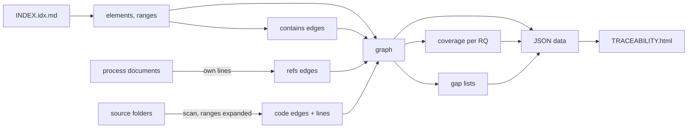

# ADR-TRC-001: Trace Generator and Link Model

## Status
Accepted — owner request of 2026-10-18 (a skill that builds the complete traceability matrix of an AGNOS process and its
sources). Motivated by RQ-TRC-001 to RQ-TRC-009, RQ-TRC-017, RQ-TRC-019 to RQ-TRC-021, RQ-TRC-023 (FTR-TRC-001).

## Context
AGNOS requires every artifact to carry the IDs of the artifacts it relates to, and source files to carry the requirement
IDs they implement (MANDATORY TRACEABILITY). Nothing checks it: `INDEX.idx.md` lists what is defined and where, but not
what references what, and no tool reads the sources. The skill must work on any project that follows AGNOS, so it may
rely only on what AGNOS fixes: the ID grammar `<TYPE>-<TRI>-<NNN>` with the six types, and the index format written by
`agnos-index` (`@<path>` then `ID|first-last|status|title`). The other AGNOS skills ship a PowerShell and a bash script
that must stay byte-identical; this one has to scan thousands of files, compute a graph and write a rich HTML page.

## Decision

### DEC-TRC-001: One Python script, standard library only
`scripts/trace_matrix.py`, Python ≥ 3.9, no third-party import (RQ-TRC-021). Arguments: `--process <dir>` (holds
`INDEX.idx.md`), `--sources <dir>` (repeatable), `--out <file>` (default `<process>/TRACEABILITY.html`), `--ext` and
`--exclude` (override the default source extensions and excluded folders: `.git`, `node_modules`, `build*`, `dist`,
`out`, `_deps`, `.venv`, `venv`, `__pycache__`), `--title`, `--generated-at` (fixed timestamp, for reproducible output,
RQ-TRC-023). Exit codes: 0 written, 1 input error (nothing written, RQ-TRC-002). The last line printed gives the element
counts and every gap count (RQ-TRC-017). The script names nothing of a product (RQ-TRC-019): the ID grammar is the one
constant.

### DEC-TRC-002: A graph computed once, at generation; the page only views it
Nodes: process elements (from the index), source files, undefined IDs. Edges, each with a kind: `contains` (parent →
child), `refs` (process element → mentioned ID, with the lines where it is mentioned), `code` (file → ID, with the line
numbers and texts). Coverage and gaps are computed by the generator and embedded with the graph, so the page holds no
traceability rule and two pages built from the same inputs are identical (RQ-TRC-023). Lists are sorted (IDs in index
order, files by path) and the JSON is written with sorted keys.

### DEC-TRC-003: Extraction rules
- **Elements and their text** (RQ-TRC-003): one element per index row. A path of the index is resolved against the
  process folder's parent, then against the process folder itself.
- **Containment** (RQ-TRC-004): within one document, the parent is the element with the smallest range that encloses the
  child's range.
- **Own lines** (RQ-TRC-005): a line of a document belongs to the innermost element whose range holds it; IDs found there
  are that element's references. Code fences are not skipped: an ID in an example still names an element.
- **IDs** match `\b(FTR|RQ|ADR|DEC|PLAN|TASK)-[A-Z]{3}-[0-9]{3}\b`. A range `<A> to|–|—|..|- <B>` of the same type and
  trigram, A ≤ B, expands to the IDs of that type and trigram *defined in the index* between A and B; an undefined end
  is kept as written (RQ-TRC-007). No other notation is expanded.
- **Sources** (RQ-TRC-006): files read as UTF-8 with replacement of undecodable bytes; a file larger than 2 MB or holding a
  NUL byte in its first 8 KB is skipped as binary or generated. Line texts are trimmed to 200 characters.

### DEC-TRC-004: Coverage and gap definitions
- **Covered**: a `code` edge reaches the requirement. **Indirect**: no `code` edge reaches it, but one reaches an element
  that is linked to it by `refs` in either direction (a decision or task that cites it, an ADR it cites) or that contains
  it. **Uncovered**: neither (RQ-TRC-008).
- **Gaps** (RQ-TRC-009): `uncovered` (RQ rated uncovered); `untasked` (RQ that no TASK references); `task-no-rq` (TASK
  that references no RQ itself — its plan's references do not count, AGNOS asks each task for its requirement refs);
  `adr-no-rq` (ADR that, with its decisions, references no RQ); `empty` (FTR with no RQ, ADR with no DEC, PLAN with no
  TASK); `isolated` (no `refs` or `code` edge touches the element or any element it contains: a feature whose
  requirements are cited is not isolated, a requirement nothing cites is);
  `undefined` (IDs referenced but not in the index); `untraced-files` (scanned source files with no ID).

## Consequences
**Easier.** One run gives every link and gap of the process; the page needs no server; the rules are in one Python file
with tests.
**Harder.** Python must be installed, which the PowerShell/bash skills do not need. A reference written in a free form
("RQ 5 of the feature") is not seen; only IDs and the listed range notations are.
**Constrained.** Indirect coverage depends on the text of decisions and tasks citing their requirements, which AGNOS
requires anyway.

## Alternatives Considered
- **A PowerShell and a bash script, byte-identical, like `agnos-index`.** Rejected: two implementations of a graph, of the
  gap rules and of an HTML generator to keep identical; the index skill pays that price for a 100-line parser only.
- **Compute the links in the page (JavaScript).** Rejected: the page would have to embed every document and source file,
  and the rules would be untestable without a browser.
- **Parse the Markdown of the process (fields `Requirement refs`, `Dependencies`).** Rejected: field names differ between
  templates and projects; an ID anywhere in an element's own lines is what AGNOS asks for.
- **Use git (blame, history).** Rejected: not needed for traceability, and the page would depend on a repository.

## Diagram

