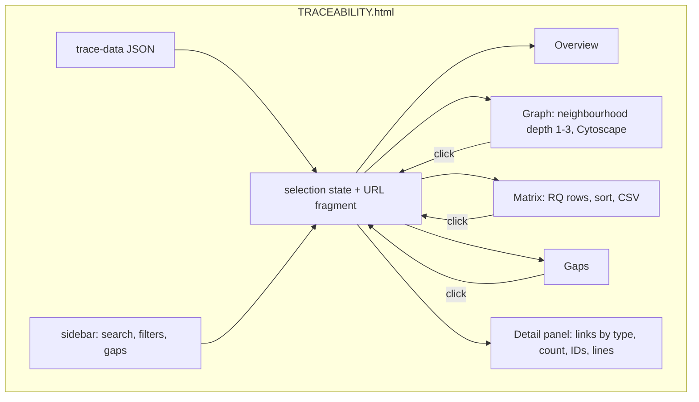

# ADR-TRC-003: Self-Contained Page and Interactive Graph

## Status
Accepted — owner decisions of 2026-10-18: Cytoscape.js, vendored and inlined. Motivated by RQ-TRC-010 to RQ-TRC-016,
RQ-TRC-020 to RQ-TRC-022, RQ-TRC-024; styled through ADR-TRC-002.

## Context
The page is opened from disk, mailed or attached; it must work offline, in any current browser, from one file. A process
of this size has about 500 elements and a few hundred source files, so a few thousand edges: a force layout of the whole
graph takes seconds and is unreadable, while the reviewer mostly asks about one element and its neighbours. The page shows
text from every scanned file, any of which can hold `</script>` or HTML.

## Decision

### DEC-TRC-005: Template assembly and safe data embedding
`assets/matrix.html` holds the page skeleton with four placeholders (tokens CSS, page CSS, scripts, data). The generator
inlines `matrix.css`, the vendored library and `matrix.js`, and the data as `<script type="application/json"
id="trace-data">` whose JSON has every `<` written `<`, so no file content can close the block (RQ-TRC-022). The
page script builds the DOM with `createElement`/`textContent` only, never `innerHTML` with data. No `src`, `href` or
`url()` points outside the file (RQ-TRC-010).

### DEC-TRC-006: Cytoscape.js, pinned and vendored, drawing neighbourhoods first
`scripts/vendor/cytoscape.min.js` at one pinned version, with `LICENSE` (MIT) and `VENDOR.md` (version, source URL,
SHA-256, RQ-TRC-024); the licence notice is inlined with it. Core layouts only, no extension. The graph view draws the
selected element and its neighbours to the chosen depth (1 to 3, `breadthfirst` from the selection), which stays under a
few hundred nodes and redraws in well under 500 ms (RQ-TRC-020); "Whole graph" draws everything with `cose`, after a
warning when there are more than 1,500 nodes. Selection: the element is outlined, its direct neighbours and edges
highlighted, the rest faded (RQ-TRC-012); clicking a node selects it.

### DEC-TRC-007: One page, four views, one selection
A header (title, generation time, inputs, theme switch), a sidebar (search with keyboard navigation, type and trigram
filters, gap shortcuts), and four views: **Overview** (counts, coverage, gaps, per-trigram bars — RQ-TRC-015), **Graph**
(RQ-TRC-012), **Matrix** (one row per requirement, sortable, filtered by the search, CSV export — RQ-TRC-014) and **Gaps**
(the lists of DEC-TRC-004). A detail panel shows the selection (RQ-TRC-013). The selection is one state shared by every
view and written to the URL fragment; `hashchange` and `popstate` restore it (RQ-TRC-016).

### DEC-TRC-008: Skill packaging
`.github/skills/agnos-trace/` holds `SKILL.md` (the canonical procedure), `scripts/trace_matrix.py`, `scripts/vendor/`,
`assets/` and `tests/` (Python `unittest` on a synthetic fixture process); `.claude/skills/agnos-trace/SKILL.md` points to
it, as for the other AGNOS skills. The generated page is not committed by the skill; a project that does not want it in
its working tree ignores the output path.

## Consequences
**Easier.** The page opens anywhere, offline, without a server; a reviewer goes from a requirement to the lines that
implement it in two clicks; a link to one element can be shared.
**Harder.** Each page carries the library (about 430 KB); a library update is a deliberate vendoring step with a new hash.
**Constrained.** The whole-graph view of a large process is slow by nature; the neighbourhood view is the default.

## Alternatives Considered
- **Load the library from a CDN.** Rejected by the owner: the page would not work offline.
- **D3.js or vis-network.** D3 is a toolkit, the graph interactions would be ours to write; vis-network is heavier for the
  same result. Cytoscape gives selection, neighbourhoods and layouts as primitives.
- **A hand-written canvas graph.** Rejected: much more code for a weaker result.
- **Mermaid diagrams.** Rejected: static, no navigation or highlighting.

## Diagram

