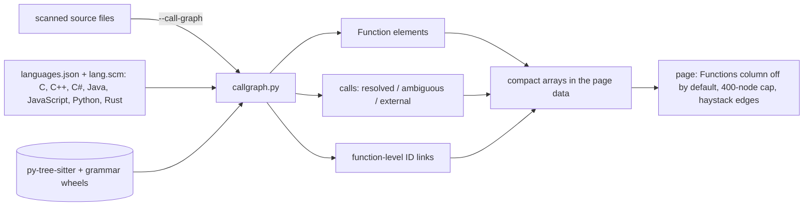

# ADR-TRC-004: Call-Graph Analysis with Tree-sitter

## Status
Accepted — reviewed and accepted by the owner on 2026-10-18, with the defaults proposed for the function key
(`fn:<file>:<first line>`), the unchanged file-based coverage (DEC-TRC-018) and `.h` read with the C++ grammar.
Owner request of 2026-10-18 (the application's call graph as one more element type of the matrix, by a
tree-sitter analysis; "attention à la partie graph centrale qui pourrait devenir lente"); owner choices: languages as
plug-ins with C/C++ first, optional pip packages, resolution by name with ambiguity shown. Motivated by RQ-TRC-026 to
RQ-TRC-040 (FTR-TRC-002). Extends ADR-TRC-001 (the link model) and ADR-TRC-003 (the page and its graph); styled through
ADR-TRC-002. Implemented by PLAN-TRC-002. Owner request of 2026-10-18 ("Ajoute le support des languages C#, JAVA,
Javascript/Node.js, python et Rust. Utiliser les binding officiels en priorité"): DEC-TRC-025 and DEC-TRC-026, for
RQ-TRC-050, implemented by PLAN-TRC-004.

## Context
The matrix links requirements to files and lines (ADR-TRC-001). A reviewer wants one step more: which functions carry
the requirement, what calls them, what they call. A syntactic parser gives functions and call sites in any language,
without a build; it cannot know types, so `x.send()` is only a name. The core generator is stdlib-only and must stay so
(RQ-TRC-021). The host repository alone has a few hundred C++ files; a medium project has tens of thousands of functions
and hundreds of thousands of call sites: the page's graph (DEC-TRC-006), its data and its adjacency lists must stay fast
with that many more nodes.

## Decision

### DEC-TRC-013: An optional module, imported only on demand
`scripts/callgraph.py`, imported by `trace_matrix.py` only when `--call-graph` is given (RQ-TRC-026, RQ-TRC-039). It uses
py-tree-sitter and one grammar wheel per language (`tree-sitter-c`, `tree-sitter-cpp`, …), all with prebuilt wheels for
Windows, Linux and macOS, no compiler needed; the supported versions are pinned in `requirements-callgraph.txt`
(`pip install -r .github/skills/agnos-trace/requirements-callgraph.txt`). The version-specific part of py-tree-sitter's
API (building a language, running a query) sits in one small adapter function. A missing package skips the language with
a message and the install command, the page is written all the same (RQ-TRC-027). The module parses the files the
scanner already selected (RQ-TRC-006): no second walk.

### DEC-TRC-014: Languages as data — a table and one query file each
`assets/callgraph/languages.json` maps a language to its file extensions, its grammar package and module, and its query
file `assets/callgraph/<language>.scm`. A query file uses fixed capture names: `@definition` (a function or method node),
`@definition.name`, `@scope` (class, struct, namespace nodes, whose names qualify the definitions inside), `@call` and
`@call.name` (the called identifier, the last part of `a.b->c::d()`). C and C++ are delivered (`.c .h` with the C grammar;
`.cc .cpp .cxx .hh .hpp .hxx .inl .ipp` with the C++ grammar, `.h` too when the C++ grammar is preferred in the table).
Adding a language is adding a table entry and a query file (RQ-TRC-032).

### DEC-TRC-015: Resolution by name, with preferences and visible ambiguity
Each call's name is looked up among the definitions of the whole project; when there are several, the first non-empty
set in this order wins: the caller's class, its namespace, its file, its folder, the project (RQ-TRC-029). One definition
left: a plain call link. Two to five: one link to each, marked `ambiguous` (RQ-TRC-030). More than five: no link, counted
as ambiguous. None: counted as external. Constructors, destructors and operators are definitions like the others;
macros, function pointers, virtual dispatch and template instantiation are not followed (FTR-TRC-002 overview).

### DEC-TRC-016: Functions in the link model, in a compact encoding
A function is a node of type `FN` and kind `function`, keyed `fn:<file>:<first line>` (unique and stable while the file
does not change above it), labelled with its qualified name. New edge kind `calls` (caller → callee, call-site lines, an
ambiguous flag); `contains` from its file; `code` from the function for the IDs of its lines and of the comment block
just above it (RQ-TRC-031) — the file keeps its own `code` links, so coverage (DEC-TRC-004) is unchanged. In the page
data, functions are one table (`[file index, first, last, qualified name, language, first-line text]`) and calls one flat
array of integers (`caller, callee, flags, line count, lines…`), file and function names stored once (RQ-TRC-038). The
page builds its adjacency lists from the arrays at load, once, without objects per call.

### DEC-TRC-017: Keeping the central graph fast
- Functions are off in the type filters when the page opens (RQ-TRC-034): a neighbourhood has no function until asked.
- The flow graph (DEC-TRC-006) gains a "Functions" column and a hard limit of 400 drawn nodes: levels are added nearest
  first and the last level is cut when the limit is reached, the status line saying how many are left out (RQ-TRC-037);
  column caps (72) and sub-columns stay.
- Call edges are hidden while the graph is panned or zoomed (`hideEdgesOnViewport`). They were first drawn in
  Cytoscape's cheapest style (`haystack`), which has no arrow; on the owner's review (RQ-TRC-044, TASK-TRC-019) they are
  `straight` edges with an arrow, caller → callee, the next cheapest style, and the 400-node limit bounds their number.
  Ambiguous calls take the warning colour. A straight edge cannot bow round a column, so around a
  selected function its column splits in three, callers · the function · callees, and calls run left to right
  (added at implementation, TASK-TRC-013).
- "Whole graph" leaves functions out unless their filter is on, and then asks first above 1,500 nodes, as today.
- The detail panel lists the first 50 callers and callees and loads the rest on request.
- Search indexes function names once at load; results stay capped at 60. It finds functions even while their type
  filter is off: that filter keeps them out of the graph only (TASK-TRC-012).

### DEC-TRC-018: What the call graph does not change
Requirement coverage, the eight gaps of DEC-TRC-004 and their total stay file-based: a requirement cited only in a file
header is covered as before. "Untraced functions" is an informational list (RQ-TRC-035). Whether a function-level rule
should ever count (for example "a requirement is covered only when a function cites it") is left to a later decision of
the owner.

### DEC-TRC-025: C#, Java, JavaScript, Python and Rust from the tree-sitter project's own grammars
Each language is one entry of the table and one query file (DEC-TRC-014), its grammar the wheel the tree-sitter project
publishes (`tree-sitter-c-sharp`, `tree-sitter-java`, `tree-sitter-javascript`, `tree-sitter-python`,
`tree-sitter-rust`), pinned beside the others (RQ-TRC-050). What each counts:

| Language | Definitions (with a body) | Boxes: namespace / class | Calls | Separator |
|---|---|---|---|---|
| C# | methods (block or `=>`), constructors, local functions | namespaces / classes, structs, interfaces, records | invocations | `.` |
| Java | methods, constructors | the package / classes, interfaces, enums, records | method invocations | `.` |
| JavaScript | function declarations, methods, functions and arrows assigned to a name, an object key or a member (`exports.f = …`) | none / classes | call expressions | `.` |
| Python | `def` | none / classes | calls | `.` |
| Rust | `fn` with a body | inline `mod` / `impl` blocks (by their type) and traits | call expressions | `::` |

`new`, macros (Rust's `println!`) and calls through a value are not followed, as in C++ (DEC-TRC-015). Python stubs
(`.pyi`) are not read: their `...` bodies would double the functions.

### DEC-TRC-026: The syntax that differs, settled in the query files
- **A namespace that encloses nothing.** Java's `package a.b;` and C#'s `namespace A.B;` stand before the classes, not
  around them: the query captures the file's root node as the `@scope`, with that name, and the table maps the root node
  type to `namespace`.
- **Attributes, annotations, decorators.** Java and C# keep them inside the definition; Python's decorators and Rust's
  `#[...]` stand between the doc comment and the definition: the query captures them as `@comment`, so the comment block
  above them reaches the definition (RQ-TRC-031).
- **Names.** Two rules of the script, valid for every language: a trailing `::` left by a removed generic argument (Rust's
  `f::<T>()`) is dropped, and a called name may hold `$` and start with `#` (JavaScript's `$()`, `this.#p()`).
- Modules that are only files (Python, JavaScript, Rust's `mod x;`) give no box: their classes are in `(global)`
  (DEC-TRC-019). A namespace taken from the file's path would be a name the code does not declare; left to a later
  decision of the owner.

## Consequences
**Easier.** "Which functions implement RQ-X, who calls them" is one selection; impact analysis before a change; new
languages without code.
**Harder.** One more optional dependency to install and pin; the analysis takes seconds on a large tree; the page grows
by a few megabytes on a large project.
**Constrained.** Syntactic resolution: an ambiguous or missed call is possible and shown as such, never invented as exact;
virtual calls, callbacks and macros are not followed; the function key changes when lines are added above a function.

## Alternatives Considered
- **clang / clangd with `compile_commands.json`.** Exact for C/C++, but needs a configured build, one tool per language
  and much more time; rejected by the owner for this feature, possible as a later "precise" mode.
- **ctags / universal-ctags.** Lists definitions well, not calls.
- **Regular expressions.** Fooled by comments, strings, templates and nested scopes; tree-sitter is exact on syntax.
- **The tree-sitter CLI.** Needs Node or Rust and locally compiled grammars; the Python wheels need neither.
- **Functions as nodes of the existing file links only (no call edges).** Answers "which function cites the requirement"
  but not "what calls it", which is the point.
- **A bundle of grammars (`tree-sitter-language-pack`) for the new languages.** One wheel for a hundred languages, but
  built by a third party, at its own pace; the owner asked for the official grammars first (DEC-TRC-025).
- **Drawing the call graph with its own force layout.** Unreadable beyond a few hundred nodes; the flow columns with a node
  cap keep the one view readable.

## Diagram

