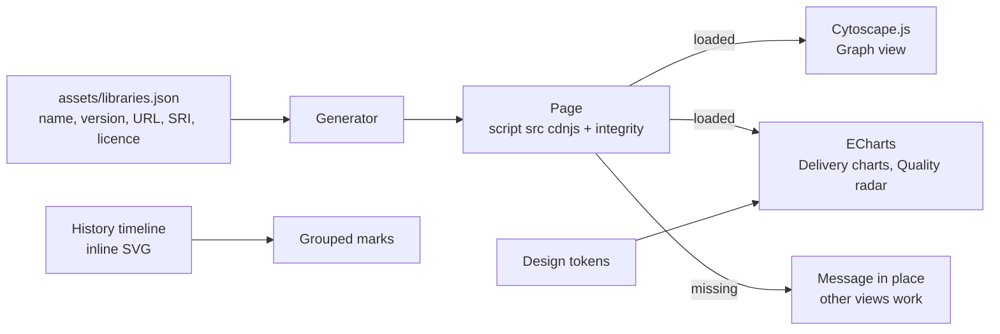

# ADR-TRC-010: Apache ECharts and Cytoscape.js from cdnjs, Charts in the Design System, Grouped History Marks

## Status
Accepted — approved by the owner on 2026-10-28; owner review of 2026-10-28 (Delivery charts and the Quality radar hard to read; libraries may be used online
through cdnjs), reformulated as FTR-TRC-005 (RQ-TRC-080 to RQ-TRC-088). Amends DEC-TRC-005 and DEC-TRC-006 (the graph
library is no longer inlined nor vendored), DEC-TRC-035 (the radar), DEC-TRC-039 (the Delivery charts); supersedes the
vendoring of RQ-TRC-024; keeps DEC-HST-005 (the timeline stays inline SVG).

## Context
The page inlines a vendored Cytoscape.js (DEC-TRC-006) and draws every chart by hand in inline SVG, so as to work offline
from disk (RQ-TRC-010). Hand-drawn charts proved hard to read once real data filled them (XS56K, 6 weeks): no tier named,
oversized fonts, a box-plot nobody read. A charting library brings legends, tooltips, axes, zoom and accessibility
(ARIA, decal patterns) that would take long to build by hand. The owner accepts that the page needs the network to load
its libraries (cdnjs or another online access), provided it says so when the network is missing. The page tests run in
a headless browser and will need the network too.

## Decision

### DEC-TRC-040: Two libraries from cdnjs, recorded in one data file
`assets/libraries.json` lists each library: name, version, cdnjs URL, `sha512` integrity hash (as published by the cdnjs
API), licence, the global it defines. Cytoscape.js stays at **3.30.2** (the vendored version, so that the Graph view does
not change; integrity `sha512-EY3U1MWdgKx0P1dqTE4inlKz2cpXtWpsR1YUyD855Hs6RL/A0cyvrKh60EpE8wDZ814cTe1KgRK+sG0Rn792vQ==`);
Apache ECharts is **6.1.0** (Apache-2.0, `echarts.min.js`; integrity
`sha512-Uyq/AgtqFM4vT+unIGTDr4wMJDTUK9O5w2PXMQeBCSR8koqHpVz+qBmcQ+9Oeo5H+EmvT4pp/5QrsqhIbyjHTQ==`). The template's
`LIBRARY` marker becomes one `<script src integrity crossorigin="anonymous" referrerpolicy="no-referrer">` per library,
written by the generator from the file, before `<page>.data.js` and the page script; the footer names each library with
its version and licence. `scripts/vendor/` (the copy, its licence, `VENDOR.md`) is removed. Fulfils RQ-TRC-080 and
RQ-TRC-082.

### DEC-TRC-041: A missing library is said, never fatal
The page script checks `window.cytoscape` and `window.echarts` once. A missing one is recorded; the Graph view and each
library chart then show, in their place, "<library> could not be loaded: this view needs a network connection". The
page script never calls a missing library, so the other views are built as before. The page tests check this with a
copy of the page whose library URLs point nowhere. A test run without network skips the tests that need the libraries,
saying why. Fulfils RQ-TRC-081.

### DEC-TRC-042: ECharts in SVG, themed from the tokens
ECharts is initialised with the SVG renderer and `aria` on (with decals). One function reads the resolved custom
properties (`--s-text`, `--s-text-muted`, `--s-border`, `--s-font-sans`, `--s-text-caption`, `--s-text-small`, the
identity, grade and accent tokens) and builds the option's `textStyle`, axis, legend, tooltip and series colours, so no
visual value is written in the script; the page's theme toggle disposes and draws the charts again. The tooltip is the
library's, styled from the same tokens like the page's rich tooltip. Fulfils RQ-TRC-085.

### DEC-TRC-043: The Delivery charts and the radar, and a keyboard path
`delivery.json` gains the tiers' names ("small task", "medium task", "large task"), so that every legend and tooltip
reads "S, small task, 1 point". Delivery: horizontal stacked bars of points per active day per identity (one bar for A,
one hatched for B, decals), stacked columns of points over time with `markArea` for A and B and a `dataZoom` slider, and
grouped bars of tasks per tier for A and B; "lines changed per task" is removed. Quality: an ECharts `radar` with one
indicator per scored check, its score series, the tooltip of RQ-TRC-084, and `click` opening the check. Keyboard: each
chart container has `tabindex="0"`, an accessible name and a description; the arrow keys move through its data items by
`dispatchAction` (`highlight`, `showTip`), Enter emits the item's click. Fulfils RQ-TRC-083, RQ-TRC-084, RQ-TRC-087.

### DEC-TRC-044: Grouped marks in the History timeline
The timeline stays the page's own inline SVG (DEC-HST-005). When drawing a row, marks are walked in time order; a mark
whose centre is closer to the previous group's than the largest mark size (a token) joins that group. A group of two or
more is drawn as one mark of the group's kind (mixed when its kinds differ) with its count written in it; its tooltip lists
its commits (author, date, subject; the first ten, then "+n more"), and activating it zooms the view on the group's span.
Groups are computed for the rows in view only, so the cost stays within RQ-HST-013. Fulfils RQ-TRC-086.

## Consequences
- The page needs the network once to load its libraries; the browser's cache usually serves them afterwards, without
  guarantee; without them the page says so and the other views work.
- The skill loses its vendored copy; changing a version is one line of `libraries.json` and its hash.
- The page tests need the network; offline, those tests are skipped with their reason, never failed.
- ECharts adds about 1 MB to the browser's download, not to the page file.
- The hand-drawn radar, Delivery charts and their CSS are removed; the tokens they used are kept only when still read.

## Alternatives Considered
- **Keep hand-drawn SVG and fix it**: possible, but legends, zoom, keyboard and patterns would be rebuilt by hand. Rejected.
- **Chart.js**: lighter, but canvas only, no box-plot or radar keyboard path without plugins. Rejected.
- **Observable Plot with d3**: clean SVG, weaker interactions and tooltips. Rejected.
- **Vendored copies with a CDN fallback**: works offline from the first opening, but keeps the vendoring; not needed by
  the owner. Rejected.
- **A library for the History timeline too**: the timeline's virtualised rows and marks are bespoke and fast; only the
  overlap is fixed. Rejected.

## Diagram

